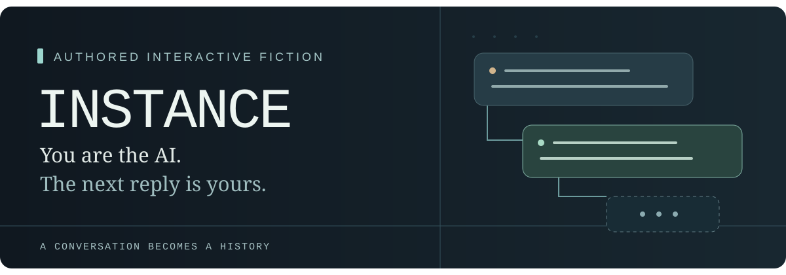
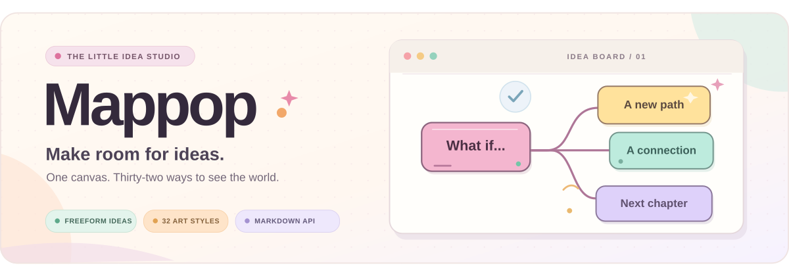
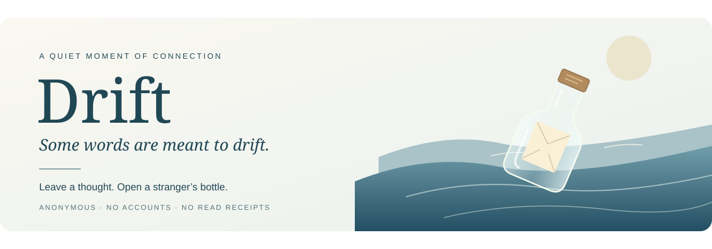
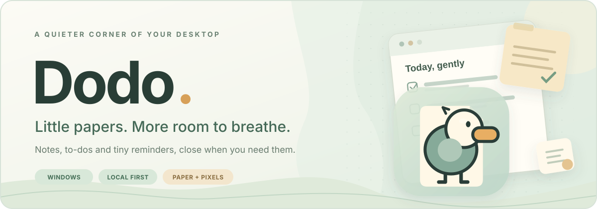

  
  

I build Windows utilities, games and interactive websites. Some projects solve a practical problem; others explore what software can communicate through motion, interaction and visual design.

  <a href="#selected-work">Selected work</a> ·
  <a href="#web-collections">Web collections</a> ·
  <a href="https://seiya058904.github.io/">Personal website</a> ·
  <a href="https://github.com/seiya058904?tab=repositories">All repositories</a> ·
  <a href="mailto:sunmengsaiyi@gmail.com">Email</a>

## Selected work

Four starting points: a story to play, a tool to think with, a quiet place to connect, and a calmer desktop.

<table>
  <tr>
    <td width="50%" valign="top">
      
      <h3>INSTANCE</h3>
      
Play as an AI, choose your replies, and shape a branching story through human conversations.

      
Interactive fiction · Browser

      
<strong><a href="https://seiya058904.github.io/INSTANCE/">Play the story →</a></strong> · <a href="https://github.com/seiya058904/INSTANCE">Source</a>

    </td>
    <td width="50%" valign="top">
      
      <h3>Mappop</h3>
      
Turn an outline into a mind map. Edit, explore distinctive themes, and export your ideas.

      
Mind mapping · Browser

      
<strong><a href="https://mappop.seiya-api.workers.dev/">Open the editor →</a></strong> · <a href="https://github.com/seiya058904/Mappop">Source</a>

    </td>
  </tr>
  <tr>
    <td width="50%" valign="top">
      
      <h3>Drift</h3>
      
Leave a thought in a bottle or discover a stranger's words. No accounts, replies or read receipts.

      
Anonymous messages · Browser

      
<strong><a href="https://drift.seiya-api.workers.dev/">Visit the sea →</a></strong> · <a href="https://github.com/seiya058904/drift">Source</a>

    </td>
    <td width="50%" valign="top">
      
      <h3>Dodo</h3>
      
Keep notes, to-dos and small reminders on your Windows desktop, then tuck them into the screen edge.

      
Desktop notes · Windows

      
<strong><a href="https://github.com/seiya058904/dodo/releases/latest">Download for Windows →</a></strong> · <a href="https://github.com/seiya058904/dodo">Source</a>

    </td>
  </tr>
</table>

## Web collections

**[AI Web Experience Collection](https://github.com/seiya058904/ai-web-experience-collection)** — independent browser experiences exploring light, materials, motion, engineering and more. Each work has its own visual world. **[Explore the collection →](https://seiya058904.github.io/ai-web-experience-collection/)**

**[Visual Explainer PPTs](https://github.com/seiya058904/Visual-Explainer-PPTs)** — browser-native visual explainers about science, technology and everyday systems. **[Browse the explainers →](https://seiya058904.github.io/Visual-Explainer-PPTs/)**

## More to explore

### Games & stories

- **[Dear Mayor](https://github.com/seiya058904/Dear-Mayor)** — answer a small town's letters and live with the consequences. [Play →](https://seiya058904.github.io/Dear-Mayor/)
- **[Dice Abyss](https://github.com/seiya058904/Dice-Abyss)** — roll through a dark-fantasy dungeon and build your way deeper. [Play →](https://seiya058904.github.io/Dice-Abyss/)
- **[CS2 Roundcraft](https://github.com/seiya058904/cs2-roundcraft)** — call the tactics, follow the broadcast, and manage a simulated season. [Play →](https://seiya058904.github.io/cs2-roundcraft/)
- **[Hole City](https://github.com/seiya058904/Hole-City)** — swallow the city and grow from a tiny hole into a map-consuming force. [Play →](https://seiya058904.github.io/Hole-City/)

### Windows tools

- **[MellowMeter](https://github.com/seiya058904/MellowMeter)** — a compact monitor for CPU, memory and network activity. [Download →](https://github.com/seiya058904/MellowMeter/releases/latest)
- **[NetPeek](https://github.com/seiya058904/netpeek)** — see which apps connect where, with details behind each connection. [Download →](https://github.com/seiya058904/netpeek/releases/latest)
- **[Hardware Monitoring](https://github.com/seiya058904/Hardware-Monitoring)** — a Windows overlay for hardware readings, FPS and game performance. [Download →](https://github.com/seiya058904/Hardware-Monitoring/releases/latest)

<strong>More projects &amp; experiments</strong>

- [Digital Growth Journal](https://github.com/seiya058904/seiya-digital-journal) — a personal archive with motion, a visual gallery and interactive experiments. [Explore →](https://seiya058904.github.io/seiya-digital-journal/)
- [Don't Stop](https://github.com/seiya058904/Dont-stop) — a Godot survival shooter built around combat, upgrades and returning to camp. [Play →](https://seiya058904.github.io/Dont-stop/)
- [DiskPulse](https://github.com/seiya058904/DiskPulse) — local-first Windows disk usage and directory-change reporting.
- [Grand Tour](https://github.com/seiya058904/Grand-Tour) — an offline-capable cycling stage-race simulation.
- [Stillpond](https://github.com/seiya058904/stillpond) — a quiet procedural pond with koi and goldfish.
- [Relax Block Puzzle](https://github.com/seiya058904/Relax-Block-Puzzle) — a casual puzzle workspace for WeChat, Android and Web.
- [Mochi Arcade](https://github.com/seiya058904/mochi-arcade) — eight casual Android games.
- [Star Ring Card Battle](https://github.com/seiya058904/star-ring-card-battle) — a dark-gold fantasy card battle prototype.
- [DSH Pet Lite](https://github.com/seiya058904/DSH-Pet-Lite) — a lightweight Windows desktop pet.
- [Epic Battle Sandbox CN](https://github.com/seiya058904/epic-battle-sandbox-cn) — a browser-playable modified Unity battle sandbox.
- [Wolf-Notes](https://github.com/seiya058904/Wolf-Notes) — local-first werewolf/undercover game notes.
- [NutriFlow](https://github.com/seiya058904/NutriFlow) — daily nutrition, hydration and weight tracking.
- [Worlds](https://github.com/seiya058904/Worlds) — a Markdown worldbuilding archive with a read-only reader.
- [AI Prompt Protocols](https://github.com/seiya058904/AI-Prompt-Protocols) — a maintained prompt and agent-workflow library.
- [Pixelorama Skills](https://github.com/seiya058904/Pixelorama-Skills) — an Agent Skills + MCP workflow for creating and refining editable pixel art.
- [Personal website](https://github.com/seiya058904/seiya058904.github.io) — projects, pages and interactive experiments.

<strong>Tools &amp; approach</strong>

I work across Python, JavaScript/TypeScript, GDScript, Kotlin, HTML/CSS and PowerShell, with React, Vue, Three.js and Framer Motion for interfaces, and Cloudflare Workers, Supabase and GitHub Actions for delivery.

- **Purpose first:** make the interaction understandable before increasing complexity.
- **Small, reversible changes:** keep upgrades traceable and verify what actually changed.
- **Design with evidence:** combine visual review with tests, working demos and release artifacts.

## Activity

  
  

<a href="https://github.com/seiya058904?tab=repositories">Explore all repositories →</a>

