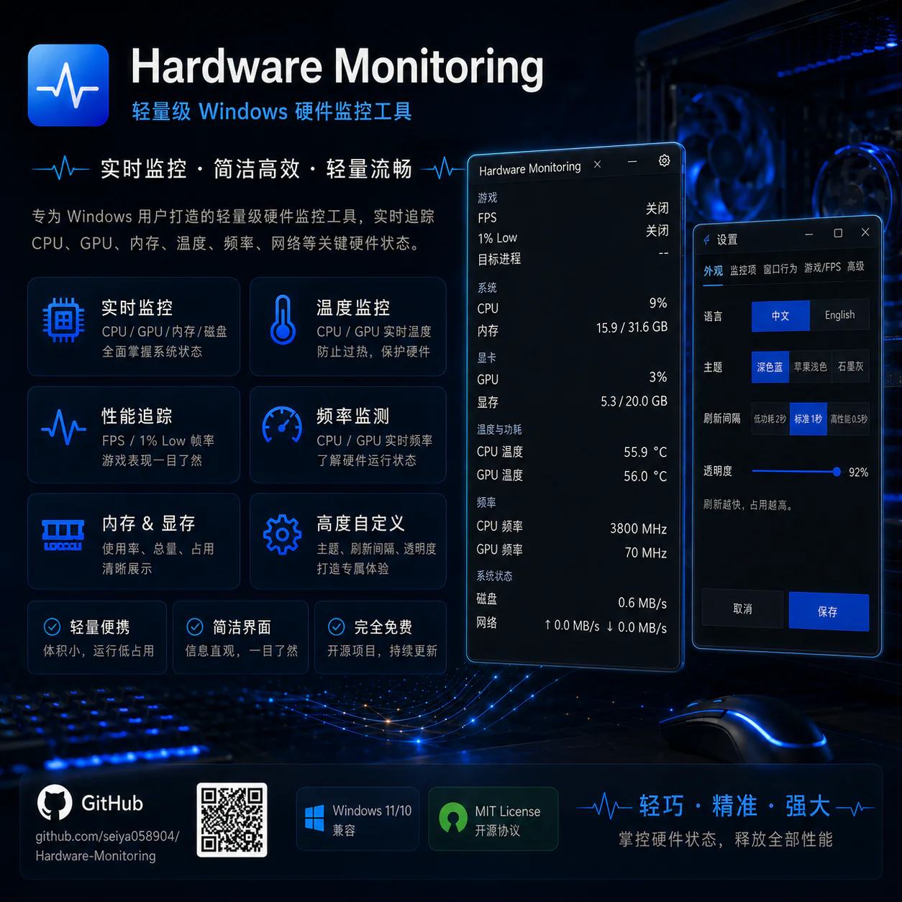
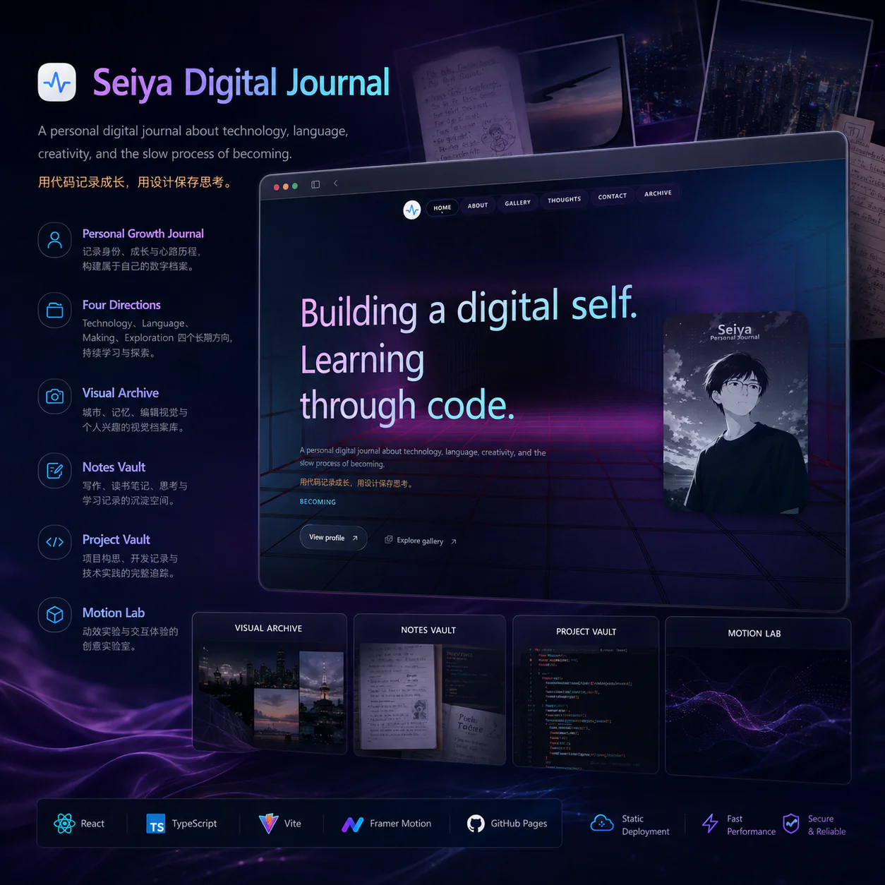
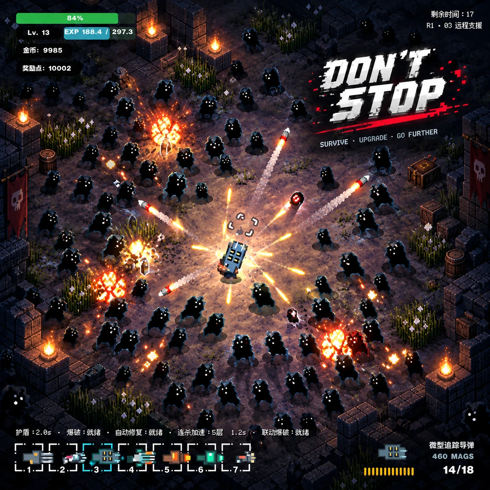

  
  

  <strong>Software · Interactive experiences · Practical experiments</strong>

  <a href="https://seiya058904.github.io/">Personal website</a> ·
  <a href="https://github.com/seiya058904?tab=repositories">Repositories</a> ·
  <a href="https://seiya058904.github.io/ai-web-experience-collection/">Web experiences</a> ·
  <a href="https://seiya058904.github.io/seiya-digital-journal/">Digital journal</a> ·
  <a href="mailto:sunmengsaiyi@gmail.com">Email</a>

# Hello, I'm Seiya 👋

I build Windows utilities, games and interactive websites. Some projects solve a practical problem; others explore what software can communicate through motion, interaction and visual design.

The recurring approach: **clear behavior, deliberate visuals, maintainable iterations and evidence from real testing**.

## Featured projects

<table>
<tr>
<td width="50%" valign="top">
  
  <strong><a href="https://github.com/seiya058904/Hardware-Monitoring">Hardware Monitoring</a></strong> 
  A compact Windows overlay for CPU, GPU, memory, temperatures, FPS and runtime health. 
  Python · Windows · Performance 
  <a href="https://github.com/seiya058904/Hardware-Monitoring/releases/latest">Download →</a>
</td>
<td width="50%" valign="top">
  
  <strong><a href="https://github.com/seiya058904/seiya-digital-journal">Digital Growth Journal</a></strong> 
  An editorial personal archive with motion, a visual gallery and interactive experiments. 
  React · TypeScript · Three.js 
  <a href="https://seiya058904.github.io/seiya-digital-journal/">Explore live →</a>
</td>
</tr>
<tr>
<td width="50%" valign="top">
  
  <strong><a href="https://github.com/seiya058904/INSTANCE">INSTANCE</a></strong> 
  A branching narrative game where you play as the AI and choose the responses. 
  Interactive fiction · React · TypeScript 
  <a href="https://seiya058904.github.io/INSTANCE/">Play →</a>
</td>
<td width="50%" valign="top">
  
  <strong><a href="https://github.com/seiya058904/Dont-stop">Don't Stop</a></strong> 
  A Godot survival shooter / roguelite built around combat, upgrades and returning to camp. 
  Godot · GDScript · Windows / Web 
  <a href="https://seiya058904.github.io/Dont-stop/">Play Web →</a>
</td>
</tr>
</table>

## Recent interactive projects

Browser projects exploring tactical decisions, playful simulation and quiet connections.

<table>
<tr>
<td width="50%" valign="top">
  
  <strong><a href="https://github.com/seiya058904/cs2-roundcraft">CS2 Roundcraft</a></strong> 
  Make the tactical calls, follow an event-driven broadcast, and manage a fictional competitive season. 
  React · TypeScript · Tactical simulation 
  <a href="https://seiya058904.github.io/cs2-roundcraft/">Play the simulation →</a>
</td>
<td width="50%" valign="top">
  
  <strong><a href="https://github.com/seiya058904/Hole-City">Hole City</a></strong> 
  Grow from a tiny hole into a map-consuming force across four modes and sixteen worlds. 
  3D · Browser game · Compiled distribution 
  <a href="https://seiya058904.github.io/Hole-City/">Play Hole City →</a>
</td>
</tr>
</table>

**[Drift](https://github.com/seiya058904/drift)** — an anonymous message-in-a-bottle experience. Leave a thought, open a stranger's bottle, and let it drift on. **[Visit the sea →](https://drift.seiya-api.workers.dev)**

## Web experiences

**[AI Web Experience Collection](https://github.com/seiya058904/ai-web-experience-collection)** gathers **38 independent cinematic web experiences**: optics, materials, engines, sculpture, typography, deep time and more. Each work has its own structure and visual identity.

**[Explore all experiences ↗](https://seiya058904.github.io/ai-web-experience-collection/)** · [Source repository](https://github.com/seiya058904/ai-web-experience-collection)

## Technical focus

| Languages | Interface & motion | Systems & delivery |
| --- | --- | --- |
| Python · JavaScript · TypeScript · GDScript · Kotlin · HTML/CSS · PowerShell | React · Vite · Vue · Three.js · Framer Motion | Supabase · Cloudflare Workers · GitHub Actions · Git · Android |

## Other projects

<strong>Browse more repositories</strong>

- [DiskPulse](https://github.com/seiya058904/DiskPulse) — local-first Windows disk usage and directory-change reporting.
- [Mochi Arcade](https://github.com/seiya058904/mochi-arcade) — eight offline-friendly casual Android games.
- [DSH Pet Lite](https://github.com/seiya058904/DSH-Pet-Lite) — independently packaged lightweight Windows desktop pet.
- [Epic Battle Sandbox CN](https://github.com/seiya058904/epic-battle-sandbox-cn) — a browser-playable modified Unity battle sandbox with generous resources.
- [Grand Tour](https://github.com/seiya058904/Grand-Tour) — an offline-capable cycling stage-race simulation.
- [Stillpond](https://github.com/seiya058904/stillpond) — a quiet procedural pond with koi and goldfish.
- [Relax Block Puzzle](https://github.com/seiya058904/Relax-Block-Puzzle) — a casual puzzle workspace for WeChat, Android and Web.
- [Star Ring Card Battle](https://github.com/seiya058904/star-ring-card-battle) — a dark-gold fantasy card battle prototype.
- [Wolf-Notes](https://github.com/seiya058904/Wolf-Notes) — local-first werewolf/undercover game notes.
- [NutriFlow](https://github.com/seiya058904/NutriFlow) — daily nutrition, hydration and weight tracking.
- [Worlds](https://github.com/seiya058904/Worlds) — a Markdown worldbuilding archive with a read-only reader.
- [Visual Explainer PPTs](https://github.com/seiya058904/Visual-Explainer-PPTs) — interactive visual explainers.
- [AI Prompt Protocols](https://github.com/seiya058904/AI-Prompt-Protocols) — a maintained prompt and agent-workflow library.
- [Personal website](https://github.com/seiya058904/seiya058904.github.io) — projects, pages and interactive experiments.

## How I build

- **Purpose first:** make the interaction understandable before increasing complexity.
- **Small, reversible changes:** keep upgrades traceable and verify what actually changed.
- **Design with evidence:** combine visual review with tests, working demos and release artifacts.

## Activity

  
  

<a href="https://github.com/seiya058904?tab=repositories">Explore the repositories →</a>

